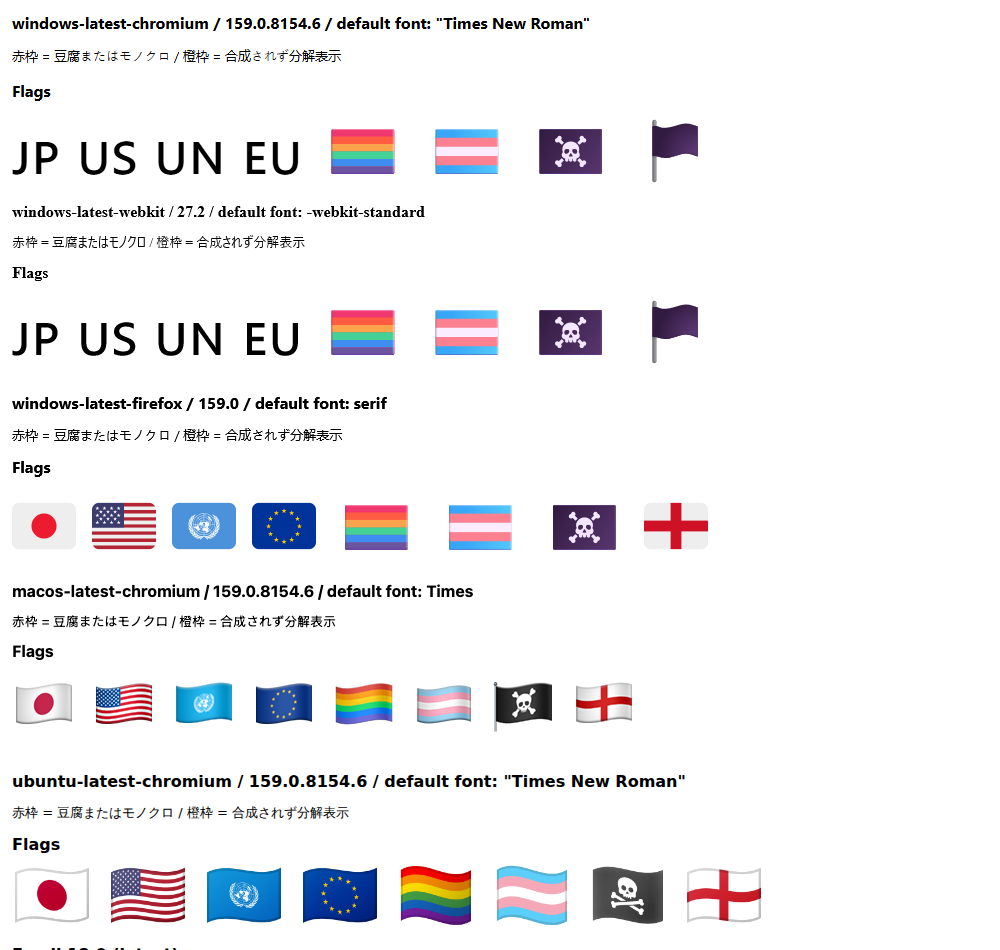

# emoji-support

ブラウザーの初期設定とプラットフォーム標準のフォントだけで、どの絵文字が豆腐にならずに表示できるかを調べる。
Webフォントは使わない。

GitHub Actions の [emoji-support ワークフロー](../.github/workflows/emoji-support.yml) で、OS 3 種類とブラウザー 4 種類の組み合わせを Playwright で検査する。

- OS: `ubuntu-latest`, `windows-latest`, `macos-latest`
- ブラウザー: Playwright の `chromium`, `firefox`, `webkit` と、ランナーにインストール済みの Google Chrome (`chrome`)

## 判定方法

対象は Unicode 公式の [`emoji-test.txt`](https://unicode.org/Public/emoji/latest/emoji-test.txt) にある fully-qualified の絵文字すべて。
[check.mjs](check.mjs) が、ブラウザーの初期フォント (`getComputedStyle(document.body).fontFamily`) で各絵文字を canvas に描いて判定する。

| 判定 | 意味 | 判定条件 |
|---|---|---|
| `ok` | カラー絵文字として 1 文字分で表示 | 赤と青の 2 色で描いた画像が一致し、幅が 😀 の 1.4 倍以下 |
| `tofu_or_mono` | 豆腐、またはモノクロの文字で表示 | 2 色で描いた画像が異なる (グリフが文字色に染まる) |
| `split` | 合成されず部品に分かれて表示 | 幅が 😀 の 1.4 倍を超える |
| `blank` | 何も描画されない | インクのあるピクセルがない |

カラー絵文字のグリフは文字色 (`fillStyle`) を無視して描かれる。
豆腐やモノクロのテキストグリフは文字色に染まる。
この違いを使って、カラー絵文字として描かれたかどうかを見分ける。

各ジョブは、判定結果の JSON と目視確認用のスクリーンショット (`recent.png`, `all.png`) をアーティファクトとして出力する。
スクリーンショットでは、`tofu_or_mono` と `blank` を赤枠、`split` を橙枠で囲む。

### 既知の限界

- 🏴󠁧󠁢󠁥󠁮󠁧󠁿 のようなタグ付きの旗は、合成に失敗しても土台の 🏴 がカラーで 1 文字分に描かれる。このため `ok` と誤判定される (Windows の Chromium/Chrome/WebKit で発生)。
- モノクロでも文字として読める表示と、豆腐とを区別しない。どちらも `tofu_or_mono` になる。
- Ubuntu では Playwright の依存パッケージとして `fonts-noto-color-emoji` が入る。Ubuntu デスクトップの初期状態と同等だが、まったく手を加えていないランナーではない。
- GitHub のランナーは Windows Server と macOS のイメージなので、一般向けの Windows 11 や最新の macOS とはフォントのバージョンが違う可能性がある。

## 結果 (2026-11-18, Unicode Emoji 18.0)

全結果: [reports/2026-11-18.md](reports/2026-11-18.md) ([実行ログ](https://github.com/kou029w/_/actions/runs/44219196613))

| | macOS (Darwin 25.6) | Ubuntu (Noto Color Emoji) | Windows Server 2025 (Segoe UI Emoji) |
|---|---|---|---|
| Emoji 18.0 | ❌ すべて豆腐 | ❌ すべて豆腐 | ❌ すべて豆腐 |
| Emoji 17.0 | ✅ | ✅ | ❌ 単体の絵文字は豆腐、組み合わせは部品に分かれて表示 |
| Emoji 16.0 | ✅ | ✅ | Chrome/Chromium/Firefox は 7/8 (🇨🇶 が不可)、WebKit は 0/8 |
| Emoji 15.1 以下 | ✅ | ✅ | ✅ (国旗を除く) |
| 🇯🇵 などの国旗 | ✅ | ✅ | Chrome/Chromium/WebKit は「JP」の文字、Firefox は ✅ |

- Google Chrome (stable) の結果は、どの OS でも Playwright の Chromium と同じだった。
- Windows の Firefox で国旗が表示されるのは、Firefox が自前の絵文字フォント (Twemoji Mozilla) を同梱しているため。OS のフォントによるものではない。
- 細かい差: macOS の全ブラウザーで ♀️ ♂️ ⚕️ がモノクロ。Windows の WebKit では肌の色つきの ☝ ✍ ⛹ と 🃏 🀄 がモノクロまたは豆腐。

### 国旗の表示

上から Windows の Chromium、WebKit、Firefox、macOS の Chromium、Ubuntu の Chromium。
Windows の Chromium と WebKit では、国旗の代わりに「JP」「US」のような 2 文字が表示される。
🏴󠁧󠁢󠁥󠁮󠁧󠁿 も合成されず、紫の 🏴 になっている。



## ローカルで実行する

```bash
npm install
npx playwright install chromium firefox webkit
npm run fetch
node check.mjs chromium emoji-test.txt out
node report.mjs out > report.md
```

`check.mjs` の第 1 引数は `chromium` / `chrome` / `firefox` / `webkit` のいずれか。
`chrome` を指定すると、インストール済みの Google Chrome を使う。
